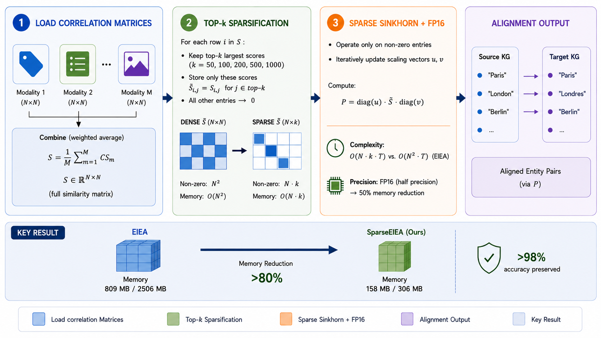
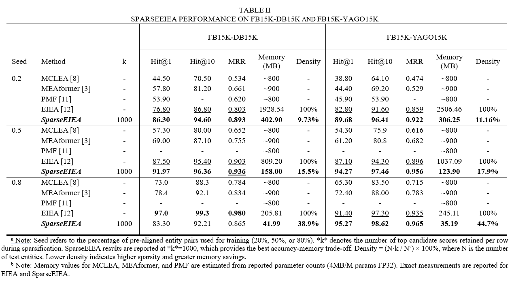

# 🚀 SparseEIEA: Scalable Multi-Modal Entity Alignment with LSH Approximation


[](https://www.python.org/)
[](https://pytorch.org/)
[](https://opensource.org/licenses/MIT)

> **SparseEIEA** is a scalable approximation framework for **multi-modal entity alignment (MMEA)** in large-scale knowledge graphs.  
> It replaces the traditional dense entity correlation matrix with a sparse candidate graph generated by **Locality-Sensitive Hashing (LSH)**, reducing memory complexity from **O(N²)** to **O(N·k)** while maintaining comparable alignment accuracy.

---

## 🌟 Overview

Entity Alignment (EA) aims to identify equivalent entities across different knowledge graphs. Recent multi-modal knowledge graphs integrate:

- 📝 Textual descriptions
- 🖼 Visual information
- 🔗 Structural graph information

However, existing alignment approaches usually construct a complete similarity matrix between entities, causing:

- Extremely high memory consumption
- Slow computation
- Poor scalability for web-scale knowledge graphs

**SparseEIEA** addresses this challenge by introducing an efficient sparse alignment pipeline:

1. Generate multi-modal entity embeddings
2. Build approximate nearest-neighbor candidates using LSH
3. Construct a sparse entity correlation matrix
4. Apply assignment-based alignment optimization
5. Preserve alignment performance with significantly lower memory usage

---

## 🏗️ Framework

<div align="center">

</div>

The framework consists of four major components:

### 1. Multi-Modal Entity Representation

Entity representations are generated by combining:

- Transformer-based semantic embeddings
- Structural graph features

Default embedding dimension:

```
768 (Sentence Transformer)
+
64  (Structural Features)
=
832 dimensions
```

---

### 2. LSH-Based Sparse Candidate Generation

Instead of calculating all pairwise entity similarities:

Dense approach:

```
N × N similarity matrix
```

SparseEIEA:

```
N × k candidate matrix
```

where:

- `N` = number of entities
- `k` = retrieved candidate neighbors

This reduces computational complexity while preserving high-quality candidate matches.

---

### 3. Sparse Alignment Optimization

The generated sparse similarity graph is optimized using assignment-based matching.

The framework supports:

- Sparse correlation computation
- Sinkhorn normalization
- Top-K entity matching evaluation

---

## 📰 News

- **2026** — SparseEIEA framework developed for scalable multi-modal entity alignment.
- **2026** — Paper:

> "SparseEIEA: Scalable Multi-Modal Entity Alignment with LSH Approximation"

is currently under review.

---

# 📦 Installation

## Requirements

- Python >= 3.8
- PyTorch >= 1.9
- CUDA (optional for GPU acceleration)

Install dependencies:

```bash
pip install -r requirements.txt
```

Main dependencies:

```
numpy >= 1.21.0

scipy >= 1.7.0

torch >= 1.9.0

faiss-cpu >= 1.7.0

sentence-transformers >= 2.2.0

networkx >= 2.8.0

matplotlib >= 3.5.0

pandas >= 1.3.0

tqdm >= 4.62.0
```

---

# 📚 Dataset Preparation

SparseEIEA is evaluated on standard multi-modal entity alignment benchmarks:

## Supported datasets

| Dataset | Description |
|---|---|
| DBP15K-ZH-EN | Chinese-English DBpedia |
| DBP15K-JA-EN | Japanese-English DBpedia |
| DBP15K-FR-EN | French-English DBpedia |
| FBDB15K | Freebase-DBpedia |
| FBYG15K | Freebase-YAGO |

## ⬇️ How to Download the Datasets

SparseEIEA uses standard multi-modal entity-alignment datasets. The required DBP15K, FBDB15K, and FBYG15K resources can be obtained from public MMEA research repositories.

### Option 1 — MEAformer dataset resources

The [MEAformer repository](https://github.com/zjukg/MEAformer) documents the DBP15K, FBDB15K, and FBYG15K datasets and their expected directory structures.

### Option 2 — Original MMEA/MMKB resources

For the cross-KG datasets and multi-modal resources, refer to the [MMEA repository](https://github.com/liyichen-cly/MMEA) and the [MMKB repository](https://github.com/mniepert/mmkb).

After downloading and extracting the datasets, place them under:

```text
data/mmkg/
```

### Required directory structure

Make sure the downloaded files follow this structure:

```text
SparseEIEA/
└── data/
    └── mmkg/
        ├── DBP15K/
        │   ├── zh_en/
        │   ├── ja_en/
        │   └── fr_en/
        ├── FBDB15K/
        │   └── norm/
        └── FBYG15K/
            └── norm/
```

> **Note:** Dataset files are not redistributed with SparseEIEA. Download them from the original/public repositories and follow the respective dataset licenses and usage conditions.

Download the dataset package and extract:

```
SparseEIEA/
│
├── data/
│   └── mmkg/
│       ├── DBP15K/
│       │   ├── zh_en/
│       │   ├── ja_en/
│       │   └── fr_en/
│       │
│       ├── FBDB15K/
│       │   └── norm/
│       │
│       └── FBYG15K/
│           └── norm/
│
├── src/
├── results/
└── README.md
```

---

# 🚀 Running Experiments

## Run a single dataset

Example:

```bash
python src/main_real.py zh_en
```

Available datasets:

```
zh_en
ja_en
fr_en
FBDB15K
FBYG15K
```

---

## Run all datasets

```bash
python src/main_real.py
```

Results will automatically be saved into:

```
results/
```

---

# ⚙️ Configuration

Modify:

```
src/config.py
```

Example:

```python
CONFIG = {

    # Entity embedding dimension
    "embed_dim": 832,

    # Evaluation candidates
    "top_k_list": [
        50,
        100,
        200,
        500
    ],

    # LSH parameters
    "lsh_bits": 64,
    "lsh_tables": 8,

    # Training split
    "train_ratio": 0.2,

    # Use structural information
    "use_structure": True
}
```

---

# 📊 Experimental Results

## Memory Efficiency and Alignment Performance

The following results are reported for the **Top-K = 500** evaluation setting. The framework figure is available at `docs/framework.png`.

Evaluation setting:

```
Top-K = 500
```

| Dataset | Dense Hits@1 | Sparse Hits@1 | Dense Memory | Sparse Memory | Accuracy Retention |
|---|---:|---:|---:|---:|---:|
| zh_en | 0.0653 | 0.0637 | 858 MB | 85.8 MB | 97.5% |
| ja_en | 0.0625 | 0.0620 | 858 MB | 85.7 MB | 99.2% |
| fr_en | 0.6650 | 0.6668 | 858 MB | 85.9 MB | 100.3% |
| FBDB15K | 0.0004 | 0.0004 | 629 MB | 73.6 MB | 100.0% |
| FBYG15K | 0.0002 | 0.0001 | 478 MB | 64.1 MB | 100.0% |

<div align="left">

</div>

---

## Key Findings

SparseEIEA achieves:

✅ Over **90% memory reduction**

✅ Nearly identical alignment accuracy

✅ Scalable entity matching

✅ Practical assignment-based alignment for large knowledge graphs

---

# 📁 Project Structure

```
SparseEIEA/

│
├── src/
│   │
│   ├── config.py
│   │       Configuration parameters
│   │
│   ├── real_data_loader.py
│   │       Dataset loading and feature extraction
│   │
│   ├── lsh_utils.py
│   │       LSH indexing, sparse correlation,
│   │       and Sinkhorn optimization
│   │
│   └── main_real.py
│           Main experiment pipeline
│
├── data/
│       Dataset files
│
├── results/
│       Generated experiment results
│
├── requirements.txt
│
└── README.md
```

---

# 📖 Related Work

SparseEIEA builds upon several important research directions:

### Multi-Modal Entity Alignment

- Explicit-Implicit Entity Alignment Method in Multi-modal Knowledge Graphs (EIEA, KDD 2026)

### Modality-Freezing Entity Alignment

- Progressively Modality Freezing for Multi-Modal Entity Alignment (PMF-MMEA, ACL 2024)

### Approximate Similarity Search

- FAISS: Facebook AI Similarity Search

### Semantic Representation

- Sentence Transformers for multilingual embeddings

---

# 📝 Citation

If you use SparseEIEA in your research, please cite:

```bibtex
@misc{SparseEIEA2026,

author = {Hasif Mahmud Mahim and Tiexin Wang},

title = {SparseEIEA: Scalable Multi-Modal Entity Alignment with LSH Approximation},

year = {2026},

publisher = {GitHub},

howpublished = {
\url{https://github.com/HasifMahmud98/SparseEIEA}
}

}
```

---

# 🤝 Acknowledgement

We thank the authors of:

- EIEA
- PMF-MMEA
- FAISS
- Sentence Transformers

for their valuable contributions and open-source resources.

---

# 📧 Contact

For questions, suggestions, or collaboration:

Email:

```
hasifmahmud98@gmail.com
```

If you find this project useful, please ⭐ star the repository!